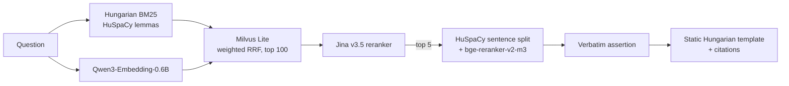

# Verbatim RAG HU

A Hungarian-language fork of [VerbatimRAG](https://github.com/KRLabsOrg/verbatim-rag)
(KR Labs): extractive question answering where every answer sentence is copied
verbatim from a source chunk and cited in the response. No LLM
writes factual content, so hallucination is prevented by construction instead of
detected afterwards.

The fork keeps the upstream pipeline (`DocumentProcessor`, `VerbatimIndex`,
`LocalMilvusStore`, templates, response builder) as implemented and swaps four
components through its existing interfaces:

| Component | Upstream (default or typical) | This fork |
|---|---|---|
| Dense embeddings | MiniLM-class sentence-transformers | `Qwen/Qwen3-Embedding-0.6B` |
| Sparse embeddings | SPLADE | Hungarian BM25 over HuSpaCy lemmas |
| Reranker | English cross-encoder | `jinaai/jina-reranker-v3.5` |
| Span extractor | LLM or ModernBERT span model | HuSpaCy sentence split + `BAAI/bge-reranker-v2-m3` or an LLM as a sentence judge |

Everything runs on one machine with Milvus Lite. The evaluation set is the
Hungarian slice of a legal dataset (EU law), described under [Dataset](#dataset).

**Status.** The retrieval stack, the cross-encoder extractor, the evaluation
runners and the eval-set demo are implemented. A trained Hungarian extractor is a possible
later phase and does not exist yet. The `api/` and `frontend/` code inherited from
upstream is a prototype outside this fork's scope; the frontend is reused only for
the eval-set demo.

## Installation

Requires Python 3.10 or newer.

```bash
git clone https://github.com/xerno42/verbatim-rag.git
cd verbatim-rag
python -m venv .venv && source .venv/bin/activate

pip install -e packages/core/        # verbatim_rag imports verbatim_core from here
pip install -e ".[dev]"

# HuSpaCy model used for lemmas (BM25) and sentence boundaries (extraction)
python -c "import huspacy; huspacy.download('hu_core_news_lg')"
# if that fails (e.g. "Invalid wheel filename ... hu_core_news_lg-any-py3-none-any"),
# which is what happens when pip resolves an old huspacy such as 0.5.1 (seen on Python 3.14):
pip install https://huggingface.co/huspacy/hu_core_news_lg/resolve/main/hu_core_news_lg-3.8.1-py3-none-any.whl
```

The demo frontend needs Node.js: `cd frontend && npm install`.

Model weights (Qwen3-Embedding, Jina reranker, bge-reranker) are downloaded from
Hugging Face on first use.

```bash
pytest tests/ -v                      # network-free tests, same as CI
ruff check packages/core/verbatim_core/ verbatim_rag/ api/ tests/
ruff format --check packages/core/verbatim_core/ verbatim_rag/ api/ tests/
```

## Repository map

| Path | Contents |
|---|---|
| [verbatim_rag/hungarian_bm25.py](verbatim_rag/hungarian_bm25.py) | `HungarianBM25Provider`: client-side BM25 over HuSpaCy lemmas |
| [verbatim_rag/qwen3_embedding.py](verbatim_rag/qwen3_embedding.py) | `Qwen3EmbeddingProvider`: dense provider with the Qwen3 query prompt |
| [verbatim_rag/rerankers.py](verbatim_rag/rerankers.py) | `JinaV3Reranker` (plus the upstream rerankers) |
| [verbatim_rag/cross_encoder_extractor.py](verbatim_rag/cross_encoder_extractor.py) | `CrossEncoderSentenceExtractor`: sentence-level span extractor |
| [verbatim_rag/](verbatim_rag/) (rest) | Upstream pipeline: `VerbatimRAG`, `VerbatimIndex`, ingestion, vector stores, templates |
| [packages/core/verbatim_core/](packages/core/verbatim_core/) | Upstream lightweight core: span extractors, `LLMClient`, templates, response builder |
| [evaluation/hu_legal/](evaluation/hu_legal/) | Eval set builder, retrieval and extraction runners, demo server, run logs (`runs/`). See its [README](evaluation/hu_legal/README.md) |
| [frontend/](frontend/) | Upstream React UI, extended with the demo panels ([HuDemoPanels.jsx](frontend/src/components/HuDemoPanels.jsx)) |
| [tests/](tests/) | Network-free tests; Hungarian ones are `test_hu_*.py`, `test_hungarian_bm25.py`, `test_qwen3_embedding.py`, `test_cross_encoder_extractor.py`, `test_rerankers.py` |

## Quick start

The quickest end-to-end path uses the eval set: build it, index it, measure
retrieval, and open the demo.

```bash
# 1. Build the Hungarian eval set into data
python -m evaluation.hu_legal.build_eval_set

# 2. Index the corpus and measure retrieval (BM25 / dense / fused / reranked).
python -m evaluation.hu_legal.run_retrieval --split test --tag baseline --rerank

# 3. Run the demo on that index (see "Demo")
python -m evaluation.hu_legal.demo --index-tag baseline
```

To query an existing index from Python, call the retrieval, rerank and extraction
stages directly. This is what `run_extraction --mode retrieved --rerank` does.

```python
from verbatim_rag.cross_encoder_extractor import CrossEncoderSentenceExtractor
from verbatim_rag.hungarian_bm25 import HungarianBM25Provider
from verbatim_rag.index import VerbatimIndex
from verbatim_rag.qwen3_embedding import Qwen3EmbeddingProvider
from verbatim_rag.rerankers import JinaV3Reranker
from verbatim_rag.vector_stores import LocalMilvusStore

run_dir = "data/index/baseline"
sparse = HungarianBM25Provider(stats_path=f"{run_dir}/bm25_hu_stats.json")
dense = Qwen3EmbeddingProvider(device="cuda")
store = LocalMilvusStore(
    db_path=f"{run_dir}/milvus.db",
    dense_dim=dense.get_dimension(),  # 1024, not the repo default of 384
)
index = VerbatimIndex(vector_store=store, dense_provider=dense, sparse_provider=sparse)

question = "Mi a tagállamok kötelezettsége a jelentéstétel során?"
hits = index.query(question, k=100, hybrid_weights={"dense": 0.5, "sparse": 0.5}, rrf_k=60)
# the model runs remote code, so pin the revision (the one the demo uses)
reranker = JinaV3Reranker(rerank_k=100, revision="e8a93f33f0b22108f8c2364f8484ce3422552fbc")
hits = reranker.rerank(question, hits)

extractor = CrossEncoderSentenceExtractor(threshold=0.5)
spans = extractor.extract_spans(question, hits[:5])   # {chunk text: [verbatim sentences]}
```

An empty `spans` (or empty span lists) is an abstention: the demo shows a fixed
Hungarian message in that case.

## Environment setup

No API key is needed for the default pipeline. All models run locally and the
answer text comes from a static template.

| Variable | Needed for |
|---|---|
| `DEEPSEEK_API_KEY` | Optional. The demo's opt-in `llm` extractor (`LLMSpanExtractor`, default `deepseek-v4-flash` at `https://api.deepseek.com/v1`; override with `--llm-model`, `--api-base`, `--llm-key-env`). The demo never reads `OPENAI_API_KEY` |
| `OPENAI_API_KEY` | Optional. `run_extraction --extractor llm` reads the key from here and defaults to `gpt-4o-mini` at `https://api.openai.com/v1`; for DeepSeek pass `--llm-model deepseek-v4-flash --api-base https://api.deepseek.com/v1` |

Practical notes:

- **CPU and GPU.** The runners default to `--device cpu` with batch size 16. The demo
  picks `cuda` when available and falls back to `cpu`, with batch size 32 on a GPU and
  16 on CPU (`--device`, `--batch-size`, `--ce-batch-size` override). Batch sizes only
  trade speed for memory. `--rerank-block-tokens 4096` fits a 16 GB card and is the
  value to keep on CPU too: it changes the ranking, so other values are not comparable
  to the baseline. The Jina reranker scores all candidates in one forward pass with
  quadratic attention memory, so 100 chunks without blocking (about 12k tokens)
  runs out of memory on a 16 GB card, which is what the blocking is for.
- **Pinned dependencies.** `transformers==4.53.3` (the Jina remote code breaks on
  newer aliases such as `dtype`), `milvus-lite<3` and `setuptools<81` (see the
  comments in [pyproject.toml](pyproject.toml)).
- **Licences.** The Jina reranker is CC-BY-NC-4.0 and the eval data is CC BY-NC-ND 4.0.
  Both make this fork a non-commercial research setup. The code is MIT.

## How it works

1. **Eval corpus indexing.** Each corpus row is one chunk keyed by `chunk_id`
   (`DocumentProcessor` chunking is bypassed so gold ids line up). BM25 statistics
   are fitted on exactly these chunk texts, then dense and sparse vectors are
   stored in Milvus Lite.
2. **Retrieval.** The question is embedded densely (Qwen3, with its query prompt)
   and sparsely (BM25 query vector). Milvus fuses both rankings with weighted
   reciprocal rank fusion (dense 0.5, sparse 0.5, k=60). The top 100 go on.
3. **Reranking.** Jina v3.5 reorders the fused top 100; the top 5 chunks go to
   extraction.
4. **Extraction.** HuSpaCy splits each chunk into sentences, the cross-encoder
   scores each (question, sentence) pair, and sentences at or above the threshold
   (0.5 by default) are kept. Spans are returned in relevance order
   (best chunk first, best sentence first within a chunk).
5. **Verbatim check** (demo and eval runner). Every emitted span must be an exact
   substring of its source chunk. A failure is logged and the span is dropped, never
   shown.
6. **Answer** (demo). A static template fills in the spans. With no spans the answer is a
   fixed Hungarian abstention message. Citations point at document and offsets.

The guarantee is about provenance: the text is the source's text. It does not cover
retrieval misses, a wrong sentence being picked, or the source being wrong. The
extractor's job is to pick well; abstention is currently the weak spot (see
[Results](#results-on-the-test-split)).

## Architecture



The structure is upstream's (`VerbatimRAG.query`: index query, optional reranker,
span extractor, template manager, response builder). Components plug in through
`DenseEmbeddingProvider`, `SparseEmbeddingProvider`, `BaseReranker` and
`SpanExtractor`. `verbatim_rag` is layered on `verbatim_core`; several of its
modules are thin re-exports, so new extractor logic goes in the core class
hierarchy or a subclass.

### Hungarian-specific decisions

**One HuSpaCy pipeline for all text analysis.** `hu_core_news_lg` with parser and
NER disabled provides lemmas for BM25 and sentence boundaries for extraction.
Generic sentence splitters break on ordinals (`1990. évi`) and abbreviations
(`kft.`, `stb.`), and each broken sentence becomes a broken answer. Known gap:
compounds (`szerződés` vs `munkaszerződés`) are not matched by lemmatization.

**BM25 is computed client-side.** Milvus Lite has no native BM25 and the store
forces `enable_full_text=False`. `HungarianBM25Provider` splits the score so the
inner product Milvus computes on `sparse_vector` equals it: document vectors hold
the saturated, length-normalized term frequency (`embed_batch`) and query vectors
hold IDF (`embed_text`). Invariants:

- `fit()` runs once before indexing, on exactly the chunk strings that get embedded.
  The statistics persist to `bm25_hu_stats.json`; the embed methods raise if unfitted.
- The same analysis (lowercased lemma, alphabetic or numeric tokens, stop words
  dropped) runs at index and query time. A mismatch silently halves recall.
- Term ids are `crc32(term) & 0x7FFFFFFF`, stable across processes. `hash()` is never used.
- A query whose terms are all unseen yields an empty vector, and the caller drops
  `sparse` from the hybrid weights for that query instead of sending `{}`.

**Dense retrieval.** `Qwen3EmbeddingProvider` applies the model's `query` prompt in
`embed_text` only (documents are embedded without it) and has dimension 1024. A
Milvus collection's schema is fixed at creation, so a different model needs a new
db file, never an existing index.

**Reranking.** `JinaV3Reranker` is a 0.6B listwise reranker. Its scores are only
comparable within one call, so it orders candidates but cannot judge sentences or
abstain. `max_block_tokens` splits the candidates into blocks scored against one
shared query embedding to bound memory; rankings differ from a single pass, so runs
with different values are not directly comparable. The tail past `rerank_k` keeps
its retrieval order, and the model revision can be pinned with `--rerank-revision`
(the demo pins `e8a93f33f0b2`).

**Sentence-level extraction.** `CrossEncoderSentenceExtractor` scores each sentence
independently with `BAAI/bge-reranker-v2-m3` (multilingual, Apache-2.0) through a
sigmoid, so scores lie in [0, 1] and a fixed threshold is meaningful. Model errors
and non-finite scores raise; they are never read as abstention.
`LLMSpanExtractor` (any OpenAI-compatible endpoint) is the quality ceiling, and an
overlap extractor (question and sentence word overlap, no model) is the floor.

**Static template and verbatim assertion.** The default `contextual` template mode
lets an LLM write framing text; the demo uses a static template with a Hungarian
filler and a fixed Hungarian abstention message. The verbatim assertion (span is an
exact substring of its chunk) is checked in `run_extraction` and in the demo. Neither
the Hungarian template nor the assertion is part of `VerbatimRAG.query` itself, whose
defaults are unchanged: pass `template_mode="static"` when using it directly.

### Results on the test split

Baseline retrieval (`evaluation/hu_legal/runs/baseline.json`, the 880 answerable test queries):

| | Sparse | Dense | Fused | Fused + Jina rerank |
|---|---|---|---|---|
| Recall@10 | 0.735 | 0.739 | 0.782 | 0.884 |
| MRR | 0.583 | 0.588 | 0.624 | 0.749 |

Fused Recall@100 is 0.908. Extraction runs over all 1,005 test queries (880
answerable, 125 unanswerable). With the cross-encoder at threshold 0.5 over the
reranked top 5: verbatim pass rate 1.0, chunk AUC 0.936, and 0.745 of queries
with the gold chunk in context are answered. The judge ranks well, but its maximum
score is a weak abstention signal (balanced accuracy about 0.67 at every threshold,
the same as the LLM extractor), so unanswerable questions are often still answered.
Run logs with full configs are in `evaluation/hu_legal/runs/`. Every change to
tokenization, models, weights or thresholds is run against the full eval set and
logged with its config.

## Demo

The demo serves the retrieved-mode pipeline above to the React UI. It has an
eval-query picker, gold-chunk marks, and a verdict per query (answered from a gold
chunk, correct abstention, retrieval miss, and so on).

```bash
# backend: reuses data/index/baseline/ when its index_meta.json matches the corpus
python -m evaluation.hu_legal.demo --index-tag baseline
# add --build to build the index if none is complete

# optional LLM extractor next to the cross-encoder (a UI toggle)
DEEPSEEK_API_KEY=... python -m evaluation.hu_legal.demo --index-tag baseline --extractors crossencoder,llm

# frontend
cd frontend && npm install && npm run dev       # http://localhost:3000, proxies /api to :8000
```

Things to know:

- Every query runs the measured configuration: request-side `k` and weights are
  ignored. Queries are served one at a time.
- Reranker errors and lost LLM calls show as errors, never as abstentions.
- The demo has its own FastAPI app in `evaluation/hu_legal/demo.py`, not `api/app.py`.

## Dataset

The eval set is built from the Hungarian slice of the
[JudicialMind Legal Training Dataset](https://huggingface.co/datasets/judicialmind/legal-training-dataset)
(`hungarian/eu/{eurlex_hu,lemur_hu}_{A,B,C}.parquet`): 10,023 query-passage pairs
from 10 EU documents, licensed CC BY-NC-ND 4.0. `data/` and `annotations/` are
gitignored for that reason; check the licence before sharing derived data.

```bash
python -m evaluation.hu_legal.build_eval_set                      # current dataset revision
python -m evaluation.hu_legal.build_eval_set --revision <hf-sha> --seed N
```

The build is deterministic for a given revision and seed. It produces `corpus.jsonl`
(8,820 chunks), `queries.jsonl` (test 1,005, dev 1,005, train 8,033), an annotation
template of 100 test queries for hand-labelled gold spans, and `manifest.json`.

Design choices worth knowing:

- Buckets A/B/C are passage lengths (up to 256, 512 and 1,024 tokens), not splits.
  Splits are drawn separately, stratified by answerability, source, bucket,
  difficulty and query type.
- `gold_chunk_ids` include overlapping chunks, so retrieving a superset chunk counts.
- Unanswerable queries (about 12% per split) are made by removing whole clusters of
  overlapping chunks from the corpus, plus 20 hand-written out-of-scope questions.
- Queries are synthetic and some do not match their passage. Word-level F1 needs
  the annotation pass (`gold_spans`) and reports `n_gold=0` until it is merged.

Metrics are reported per method and split by `query_type`, `legal_domain` and
`difficulty`: Recall and MRR (`run_retrieval`), and `run_extraction` for extraction,
abstention and verbatim assertion metrics:

```bash
python -m evaluation.hu_legal.run_retrieval --split test --tag NAME --device cuda --rerank --rerank-block-tokens 4096
python -m evaluation.hu_legal.run_extraction --mode oracle --split dev --distractors 2
python -m evaluation.hu_legal.run_extraction --mode retrieved --index-tag baseline --device cuda --rerank --rerank-block-tokens 4096
```

Both runners default to `--device cpu`, and `--rerank` without `--rerank-block-tokens`
scores all candidates in one pass.

Full details, including the annotation workflow and caveats, are in the
[eval set README](evaluation/hu_legal/README.md).

## Contributing and licence

See [CONTRIBUTING.md](CONTRIBUTING.md) and [CHANGELOG.md](CHANGELOG.md). Changes to
span validation, citations, templates, schemas or defaults need an explanation.
The code is MIT licensed ([LICENSE](LICENSE)); model and data licences are noted
above.

## Upstream and citation

This fork builds on [VerbatimRAG](https://github.com/KRLabsOrg/verbatim-rag) by KR
Labs ([paper](https://arxiv.org/abs/2605.21102),
[models](https://huggingface.co/collections/KRLabsOrg/verbatim-rag-v1)). If you use
the approach in research, please cite the upstream work:

```bibtex
@misc{Recski:2026,
    title={ACL-Verbatim: hallucination-free question answering for research},
    author={Gábor Recski and Szilveszter Tóth and Nadia Verdha and István Boros and Ádám Kovács},
    year={2026},
    eprint={2605.21102},
    archivePrefix={arXiv},
    primaryClass={cs.CL},
    url={https://arxiv.org/abs/2605.21102},
}

@inproceedings{kovacs-etal-2025-kr,
    title = "{KR} Labs at {A}rch{EHR}-{QA} 2025: A Verbatim Approach for Evidence-Based Question Answering",
    author = "Kovacs, Adam  and
      Schmitt, Paul  and
      Recski, Gabor",
    booktitle = "Proceedings of the 24th Workshop on Biomedical Language Processing (Shared Tasks)",
    month = aug,
    year = "2025",
    address = "Vienna, Austria",
    publisher = "Association for Computational Linguistics",
    url = "https://aclanthology.org/2025.bionlp-share.8/",
    pages = "69--74",
}
```
